<div align="center">


<br>

<a href="#instalacion"></a>
<a href="#tests"></a>
<a href="#tests"></a>
<a href="#arquitectura"></a>
<a href="#equipo"></a>

<h3>Investiga cualquier tema sin salir de la terminal.</h3>

Escribe un tema y un idioma. Joselito lo busca en **Wikipedia**, lo amplía con **IA**,<br>
lo traduce con **Google Translate** y te lo guarda como documento de estudio en **PDF** o **TXT**.

<p>
<a href="#demo">Demo</a>&nbsp;&nbsp;&nbsp;/&nbsp;&nbsp;&nbsp;
<a href="#como-funciona">Cómo funciona</a>&nbsp;&nbsp;&nbsp;/&nbsp;&nbsp;&nbsp;
<a href="#capturas">Capturas</a>&nbsp;&nbsp;&nbsp;/&nbsp;&nbsp;&nbsp;
<a href="#instalacion">Instalación</a>&nbsp;&nbsp;&nbsp;/&nbsp;&nbsp;&nbsp;
<a href="#arquitectura">Arquitectura</a>&nbsp;&nbsp;&nbsp;/&nbsp;&nbsp;&nbsp;
<a href="#tests">Tests</a>&nbsp;&nbsp;&nbsp;/&nbsp;&nbsp;&nbsp;
<a href="#equipo">Equipo</a>
</p>

</div>

<br>

<a name="demo"></a>

## ▍Míralo en acción


<p><em>Una sesión real, condensada: tema <b>«Agujero negro»</b>, traducción al <b>inglés</b>. Los textos que ves son los que devolvieron Wikipedia, DeepSeek y Google Translate en esa ejecución.</em></p>

<br>

<a name="como-funciona"></a>

## ▍De un tema a un documento


Cada paso tiene su propio color en la terminal, igual que en el esquema de arriba, para que siempre sepas en qué punto estás.

<table>
<tr>
<td width="50%" valign="top">

**Confirma antes de gastar**<br>
Te enseña el primer resultado de Wikipedia y te pregunta si era eso. Si no, te ofrece hasta cinco más para elegir, o volver a escribir el tema. Nada se envía a la IA hasta que dices que sí.

</td>
<td width="50%" valign="top">

**Amplía sin inventar**<br>
La IA añade explicaciones y contexto, pero se le pide expresamente que sea fiel al artículo original y que no invente datos.

</td>
</tr>
<tr>
<td valign="top">

**Te habla claro cuando algo falla**<br>
Sin internet, Wikipedia lenta o saturada, sin saldo en la IA… Cada caso tiene un mensaje en español que dice qué pasó y qué hacer. Reintenta solo cuando tiene sentido.

</td>
<td valign="top">

**Sigue aunque falte una pieza**<br>
Si la IA no está disponible, Joselito no se cae: te avisa, sigue con la traducción y guarda el documento marcando lo que falta. La traducción sí es imprescindible: si falla, te explica el motivo y termina.

</td>
</tr>
<tr>
<td valign="top">

**Documentos listos para estudiar**<br>
PDF con tipografía DejaVu incluida (tildes y eñes perfectas) o TXT plano. Si pides resumen breve, va en su propio archivo, con el formato que elijas.

</td>
<td valign="top">

**Deja rastro de todo**<br>
Cada ejecución escribe su propio registro en <code>logs/</code>, con fecha, nivel y un identificador, para poder seguir cualquier problema paso a paso. Si una clave de la IA aparece en un mensaje, se sustituye por <code>***</code> antes de escribirla.

</td>
</tr>
</table>

<br>

<a name="capturas"></a>

## ▍Capturas

Haz clic en cada paso para desplegarlo.

<details open>
<summary><b>1. Te saluda y te pregunta qué quieres investigar</b></summary>
<br>
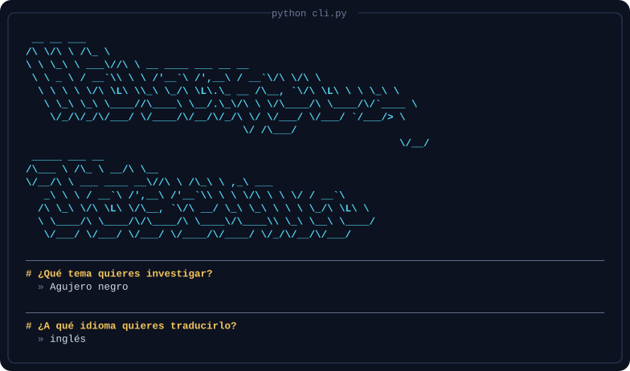
</details>

<details>
<summary><b>2. Busca y te deja elegir el resultado correcto</b></summary>
<br>
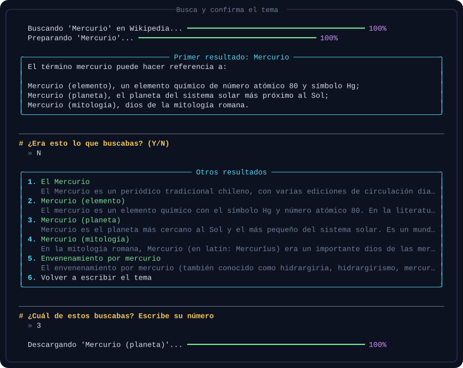
<p><em>«Mercurio» puede ser un planeta, un elemento químico o un dios romano. Joselito te enseña las opciones reales de Wikipedia y tú eliges.</em></p>
</details>

<details>
<summary><b>3. Muestra el artículo original</b></summary>
<br>
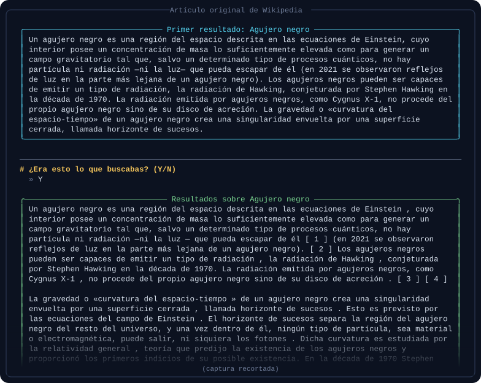
</details>

<details>
<summary><b>4. Lo enriquece con IA</b></summary>
<br>
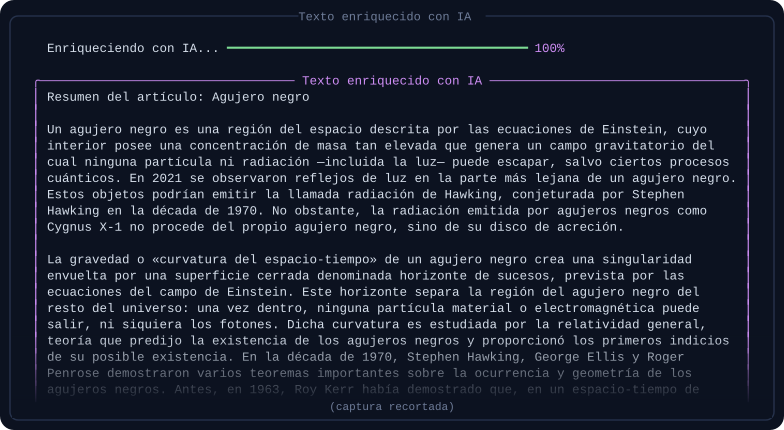
</details>

<details>
<summary><b>5. Lo traduce al idioma que elegiste</b></summary>
<br>
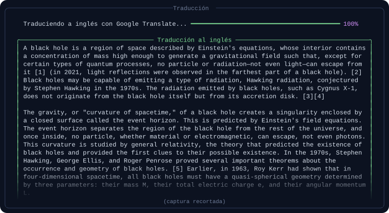
</details>

<details>
<summary><b>6. Si quieres, te hace un resumen breve</b></summary>
<br>
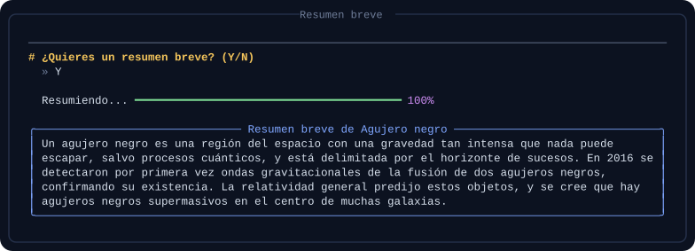
</details>

<details>
<summary><b>7. Lo guarda y se despide</b></summary>
<br>
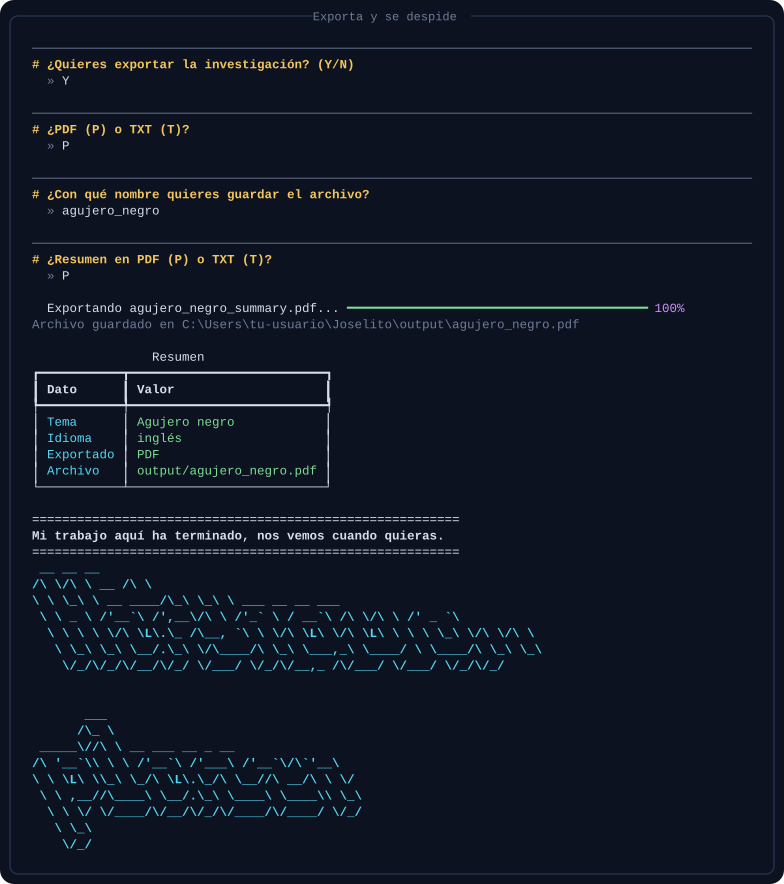
</details>

<details>
<summary><b>Y cuando algo sale mal, te lo explica</b></summary>
<br>
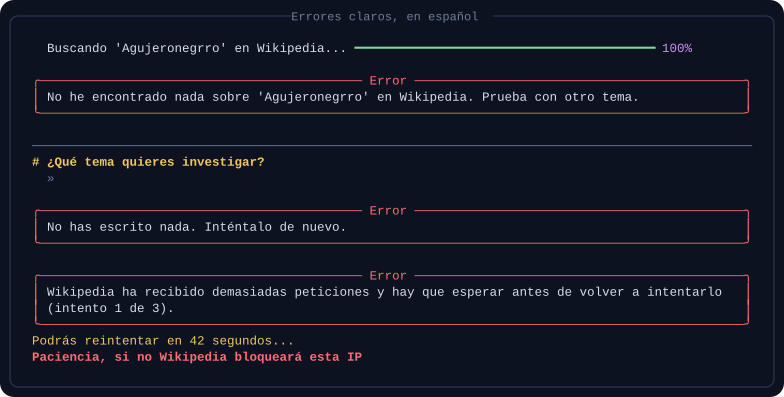
</details>

<br>

### El resultado


<p><em>El PDF reúne las tres versiones del texto, una detrás de otra. Este es el archivo real de la sesión de la demo.</em></p>

<br>

<a name="instalacion"></a>

## ▍Pruébalo en tu ordenador

**Necesitas:** Python 3.11 o superior, Git, una clave de [DeepSeek](https://platform.deepseek.com) y una clave de [Google Cloud Translation](https://console.cloud.google.com/apis/library/translate.googleapis.com) (versión Basic v2).

> [!TIP]
> ¿Nunca has instalado un proyecto de Python? La guía [INSTALACION.md](INSTALACION.md) lo explica desde cero, terminal por terminal.

**1. Descarga el proyecto**

```bash
git clone https://github.com/webcartaonline/Joselito.git
cd Joselito
```

**2. Crea y activa un entorno virtual** (una "caja" aislada para las librerías del proyecto)

<details>
<summary>Windows (PowerShell)</summary>

```powershell
python -m venv .venv
.venv\Scripts\Activate.ps1
```
</details>

<details>
<summary>macOS / Linux</summary>

```bash
python3 -m venv .venv
source .venv/bin/activate
```
</details>

**3. Instala las dependencias**

```bash
pip install -r requirements.txt
pip install -e .
```

**4. Pon tus claves.** Copia la plantilla `.env.example`, llámala `.env` y rellena los valores:

```ini
DEEPSEEK_API_KEY=sk-...
GOOGLE_TRANSLATE_API_KEY=...
```

> [!IMPORTANT]
> `.env` nunca se sube a GitHub (está en `.gitignore`). Comparte las claves por un canal privado, no en el repositorio.

**5. Arranca a Joselito**

```bash
python cli.py
```

O pásale el tema y el idioma directamente:

```bash
python cli.py --tema "Agujero negro" --idioma inglés
```

<details>
<summary><b>Todas las opciones y variables</b></summary>
<br>

| Opción | Para qué sirve | Ejemplo |
|---|---|---|
| `--tema` | Tema que quieres investigar | `--tema "Revolución francesa"` |
| `--idioma` | Idioma al que se traduce | `--idioma alemán` |

| Variable en `.env` | Obligatoria | Qué hace |
|---|:---:|---|
| `DEEPSEEK_API_KEY` | Sí | Clave para enriquecer y resumir con IA. Sin ella Joselito funciona, pero sin IA |
| `GOOGLE_TRANSLATE_API_KEY` | Sí | Clave para traducir |
| `DEEPSEEK_MODEL` | No | Modelo de IA (por defecto `deepseek-chat`) |
| `DEEPSEEK_SUMMARIZER_MODEL` | No | Modelo solo para el resumen breve |
| `DEEPSEEK_BASE_URL` | No | Dirección de la API de DeepSeek (por defecto `https://api.deepseek.com/v1`) |
| `LOG_LEVEL` | No | Detalle del registro: `DEBUG`, `INFO` (por defecto), `WARNING`… |

¿No sabes si el programa lee tu clave de DeepSeek? Ejecuta `python diagnostico_env.py`: te lo dice sin mostrar la clave entera.

</details>

<br>

<a name="arquitectura"></a>

## ▍Cómo está construido

Joselito sigue una **arquitectura hexagonal** (también llamada *puertos y adaptadores*).

Piensa en los enchufes de casa: el núcleo del programa define la forma del enchufe (el **puerto**) y cada servicio externo es un aparato con su clavija (el **adaptador**). Cuando el equipo cambió de Hugging Face a DeepSeek, o de Deep Translate a Google Translate, solo hubo que cambiar el aparato: el núcleo no se tocó.

> [!TIP]
> En [docs/architecture.md](docs/architecture.md) está la arquitectura explicada paso a paso, con una animación del flujo completo. Y si abres [docs/flujo-interactivo.html](docs/flujo-interactivo.html) en el navegador (descárgalo y haz doble clic), puedes entrar en cada paso y ver quién habla con quién, qué sale en la terminal y qué pasa cuando algo falla.

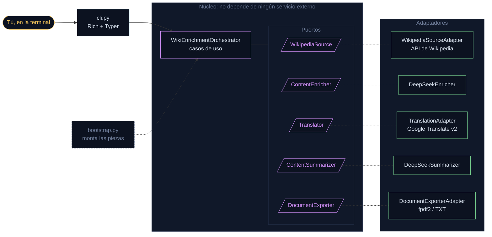

<details>
<summary><b>Mapa de carpetas</b></summary>

```text
Joselito/
├── cli.py                     ← la terminal: preguntas, paneles y colores
├── src/
│   ├── domain/                ← el corazón: modelos, puertos y errores propios
│   ├── application/           ← los casos de uso (el orquestador)
│   ├── infrastructure/        ← adaptadores: Wikipedia, DeepSeek, Google, PDF/TXT, logs
│   │   └── fonts/             ← tipografía DejaVu para los PDF
│   └── bootstrap.py           ← el único sitio donde se montan las piezas
├── tests/
│   ├── features/              ← historias de usuario en Gherkin
│   ├── step_definitions/      ← los pasos que las comprueban
│   └── helpers/               ← servicios falsos para no gastar APIs reales
├── docs/
│   ├── architecture.md        ← la arquitectura, con más detalle
│   ├── flujo-interactivo.html ← el flujo animado e interactivo (ábrelo en el navegador)
│   ├── img/                   ← la animación del flujo
│   └── assets/                ← las imágenes de este README
├── output/                    ← aquí aparecen tus PDF y TXT
└── logs/                      ← un registro por ejecución
```
</details>

<details>
<summary><b>Librerías y servicios</b></summary>
<br>

| Pieza | Para qué la usamos |
|---|---|
| [Rich](https://github.com/Textualize/rich) | Paneles de colores, barras de progreso y tablas en la terminal |
| [Typer](https://typer.tiangolo.com) | Opciones de la línea de comandos (`--tema`, `--idioma`) |
| [pyfiglet](https://github.com/pwaller/pyfiglet) | Los letreros grandes de bienvenida y despedida |
| [requests](https://requests.readthedocs.io) + [Beautiful Soup](https://www.crummy.com/software/BeautifulSoup/) | Hablar con Wikipedia y limpiar el HTML del artículo |
| [DeepSeek](https://platform.deepseek.com) | Enriquecer el texto y hacer el resumen breve |
| [Google Cloud Translation](https://cloud.google.com/translate) | Traducir al idioma elegido |
| [fpdf2](https://py-pdf.github.io/fpdf2/) | Crear los PDF |
| [python-dotenv](https://github.com/theskumar/python-dotenv) | Leer las claves del archivo `.env` |
| [pytest](https://pytest.org) + [pytest-bdd](https://pytest-bdd.readthedocs.io) + [pytest-cov](https://pytest-cov.readthedocs.io) | Tests unitarios, escenarios en Gherkin y cobertura |
| [pypdf](https://pypdf.readthedocs.io) | Leer los PDF generados en los tests para comprobar su contenido |

</details>

<br>

<a name="tests"></a>

## ▍Calidad y tests


Los tests usan **servicios falsos** que imitan a Wikipedia, DeepSeek y Google: así se pueden pasar sin internet, sin gastar saldo y siempre con el mismo resultado.

```bash
pytest
```

`pytest` ya muestra la cobertura al final, línea por línea. La cobertura se mide sobre `src/` (`cli.py` no entra en el cálculo). Datos del 16/10/2026.

<details>
<summary><b>Historias de usuario cubiertas con Gherkin</b></summary>
<br>

Cada historia de usuario tiene su archivo `.feature`, escrito en lenguaje casi natural:

| Archivo | Qué comprueba |
|---|---|
| `wikipedia_scraping.feature` | Encontrar un artículo, temas sin resultados, Wikipedia lenta o sin red |
| `search_confirmation.feature` | Confirmar el primer resultado, elegir otro o volver a escribir el tema |
| `enrichment.feature` | Enriquecer el artículo con IA |
| `translation.feature` | Traducir el artículo, traductor lento o que falla |
| `summary.feature` | Aceptar o rechazar el resumen breve, que falle, y que no se ofrezca sin texto de IA |
| `export.feature` | Exportar a PDF o TXT, apartados vacíos, formato no admitido, nombres no válidos, falta de permisos |
| `error_messages.feature` | Mensajes claros sin conexión, esperas de Wikipedia, IA lenta, Ctrl+C |
| `logging.feature` | Registro de eventos con fecha y nivel, sin datos sensibles ni claves de DeepSeek |

```gherkin
Scenario: Nothing is enriched until the user confirms
  Given Wikipedia finds 6 results about trees
  When I search "Alboles" and answer "N"
  Then nothing is enriched
```

</details>

<br>

<a name="equipo"></a>

## ▍El equipo

Proyecto del bootcamp de desarrollo con Python, hecho en **dos sprints de Scrum** (del 30 de septiembre al 14 de octubre de 2026) con Jira, Gitflow, *pull requests* revisadas y commits convencionales.

<table align="center">
<tr>
<td align="center" width="25%">
<a href="https://github.com/El-Jesule"></a><br>
<b>Jesús</b><br>
Scrum Master<br>Backend<br>
<a href="https://github.com/El-Jesule"><code>GitHub</code></a>
<a href="https://www.linkedin.com/in/jesús-gon-góm/"><code>LinkedIn</code></a>
</td>
<td align="center" width="25%">
<a href="https://github.com/kvadrakola"></a><br>
<b>Konsta</b><br>
Product Owner<br>Backend<br>
<a href="https://github.com/kvadrakola"><code>GitHub</code></a>
</td>
<td align="center" width="25%">
<a href="https://github.com/mjrr39sevilla"></a><br>
<b>María</b><br>
Backend<br><br>
<a href="https://github.com/mjrr39sevilla"><code>GitHub</code></a>
<a href="https://www.linkedin.com/in/maria-jose-rodriguez-ramos"><code>LinkedIn</code></a>
</td>
<td align="center" width="25%">
<a href="https://github.com/webcartaonline"></a><br>
<b>Camilo</b><br>
Backend<br><br>
<a href="https://github.com/webcartaonline"><code>GitHub</code></a>
<a href="www.linkedin.com/in/camilo-piamba"><code>LinkedIn</code></a>
</td>
</tr>
</table>

<br>


