# Arquitectura

Joselito (paquete `wiki-enrichment`) busca un tema en Wikipedia, lo enriquece con
IA (DeepSeek), lo traduce (Google Cloud Translation) y lo guarda en TXT o PDF.
Este documento explica cómo está organizado el código y qué pasa en cada paso.

> Revisado el 16/10/2026 contra el código de la rama `fix/update-docs`, que ya incluye
> los cambios de `dev` hasta `3d1eb66`. Los datos de los tests se han comprobado
> ejecutando `pytest`.



**Versión interactiva:** abre [`docs/flujo-interactivo.html`](flujo-interactivo.html)
en el navegador (en tu ordenador, doble clic sobre el archivo). Ahí puedes:

- hacer clic en cada paso para ver su animación: quién habla con quién y qué
  aparece en la terminal en cada momento;
- avanzar, retroceder o pausar momento a momento (también con ← → y espacio);
- ver qué pasa cuando algo falla (sin conexión, sin clave de IA, etc.);
- ver las capas como enchufes y cambiar entre las piezas reales y las de los tests.

> GitHub enseña el código de los archivos `.html` en lugar de abrirlos. Para verlo
> desde GitHub hay que descargarlo o publicarlo con GitHub Pages.

---

## La idea en una frase

El proyecto usa **puertos y adaptadores** (arquitectura hexagonal) con
**inyección de dependencias pura** (sin librerías de inyección).

Dicho de forma sencilla: el centro del programa tiene **enchufes** (puertos) y
cada servicio externo se conecta con un **aparato** (adaptador). El centro no sabe
qué marca hay enchufada.

> Ejemplo: el orquestador pide «traduce este texto» al enchufe `Translator`. Hoy
> está enchufado `TranslationAdapter` (Google). Se podría enchufar otro traductor
> sin tocar el orquestador. En los tests se enchufa `FakeTranslator`, que no usa
> internet.

## Capas

| Capa | Dónde | Qué contiene |
|---|---|---|
| **Dominio** | `src/domain/` | Modelos de datos (`models.py`), puertos (`ports.py`) y errores propios (`exceptions.py`). |
| **Aplicación** | `src/application/wiki_enrichment_orchestrator.py` | `WikiEnrichmentOrchestrator`: coordina los pasos usando solo los puertos. |
| **Infraestructura** | `src/infrastructure/` | Adaptadores concretos: Wikipedia, DeepSeek, Google Translate, exportador TXT/PDF, suplentes de IA y configuración del log. |
| **Composición** | `src/bootstrap.py` | `build_orchestrator()`: el **único** sitio que crea adaptadores concretos y los conecta. También carga el `.env`. |
| **Presentación** | `cli.py` (raíz del repo) | La interfaz de terminal: Typer (opciones), Rich (paneles, barras, tablas) y pyfiglet (carteles). |

`pyproject.toml` instala los paquetes `domain`, `application` e `infrastructure`
(carpeta `src/`) y el módulo `bootstrap`. Por eso se importa
`from bootstrap import build_orchestrator`, no `wiki_enrichment.bootstrap`.

### Dirección de las dependencias

Las dependencias apuntan **hacia dentro**: lo de fuera conoce lo de dentro, nunca
al revés.

- **Dominio** no importa nada del proyecto: solo `dataclasses` y `typing`.
- **Aplicación** importa el dominio (modelos, puertos y errores).
- **Infraestructura** importa el dominio para devolver sus modelos y lanzar sus errores.
- **Composición** importa todo para poder montarlo.
- **Presentación** pide todo el trabajo al orquestador. Además importa modelos y
  errores del dominio (para mostrar datos y capturar errores), `bootstrap` (para
  montar las piezas) y `infrastructure.logging_config` (para configurar el log).

Los puertos son `typing.Protocol`: los adaptadores **no heredan** de ninguna clase,
basta con que tengan los mismos métodos (tipado estructural).

> **Excepción a la regla:** el orquestador (aplicación) importa `LOGGER_NAME` de
> `infrastructure.logging_config`. Es solo el nombre del logger, pero es una
> dependencia de dentro hacia fuera.

## Puertos y adaptadores

| Puerto (`domain/ports.py`) | Métodos | Adaptador real | Suplente si falta la clave | En los tests |
|---|---|---|---|---|
| `WikipediaSource` | `fetch_article(topic)`, `search(topic)`, `fetch_article_by_title(title)` | `WikipediaSourceAdapter` (`wikipedia.py`) | — | `FakeWikipediaSource` |
| `ContentEnricher` | `enrich(article)` | `DeepSeekEnricher` (`deepseek_enricher.py`) | `AIContentEnricher` (`ai.py`) | `FakeContentEnricher` |
| `ContentSummarizer` | `summarize(text)` | `DeepSeekSummarizer` (`deepseek_summarizer.py`) | `AIContentSummarizer` (`ai.py`) | doble con `create_autospec` |
| `Translator` | `translate(text, target_lang)` | `TranslationAdapter` (`translation.py`) | — | `FakeTranslator` |
| `DocumentExporter` | `export_txt`, `export_pdf`, `export_summary_txt`, `export_summary_pdf` | `DocumentExporterAdapter` (`exporters.py`) | — | `FakeDocumentExporter` |

Los dobles de test están en `tests/helpers/fake_adapters.py`.

**Suplentes de IA:** si falta `DEEPSEEK_API_KEY`, el constructor de DeepSeek lanza
un error y `bootstrap` enchufa en su lugar `AIContentEnricher` /
`AIContentSummarizer`. Estos cumplen el mismo puerto pero **siempre** lanzan un
error con el motivo. Así el programa arranca y el aviso aparece justo cuando hace
falta la IA.

### Detalles de cada adaptador

- **`WikipediaSourceAdapter`**: idioma `es` (lo fija el CLI). Búsqueda con la API
  (`generator=search`, hasta 6 resultados con 2 frases cada uno y sugerencia
  ortográfica). Descarga la página (`/wiki/<título>`) y se queda con los 5 primeros
  párrafos con texto (`BeautifulSoup`, `div#mw-content-text`). Espera máxima 10 s.
  Convierte los fallos de red en errores del dominio (429 → `RateLimitError` con
  los segundos de `Retry-After`).
- **`DeepSeekEnricher`**: `POST {base}/chat/completions`, modelo `deepseek-chat`
  por defecto, recorta el artículo a 4.000 caracteres, `max_tokens=600`, 60 s.
  Instrucción: responder en español, ser fiel al artículo y no inventar datos.
- **`DeepSeekSummarizer`**: igual que el anterior pero pide 3 o 4 frases,
  `max_tokens=200`.
- **`TranslationAdapter`**: Google Cloud Translation Basic v2. Idioma de origen fijo
  `es`. Convierte nombres a códigos (inglés → `en`, francés → `fr`, alemán → `de`,
  italiano → `it`, portugués → `pt`, catalán → `ca`, japonés → `ja`, español → `es`);
  otro nombre se envía tal cual. Parte el texto en trozos de 5.000 caracteres como
  mucho. Reintenta hasta 2 veces con 429 o 5xx. La clave va en la cabecera
  `x-goog-api-key` y se borra de los mensajes de error.
- **`DocumentExporterAdapter`**: TXT en UTF-8 y PDF A4 con `fpdf2` y la fuente
  DejaVu incluida en `infrastructure/fonts/` (acentos, griego, cirílico). Crea las
  carpetas que falten y sobrescribe el archivo si ya existe. Si falla, lanza
  `ExportError`.
- **`logging_config`**: un log por ejecución en `logs/app_<run_id>.log`
  (`run_id` = 8 caracteres), rotación de 1 MB con 5 copias, hora UTC, nivel con
  `LOG_LEVEL` (por defecto `INFO`). Un filtro sustituye por `***` las claves de
  Hugging Face (`hf_…`) y de DeepSeek (`sk-…`) antes de escribirlas.

## Modelos del dominio

Todos son `dataclass(frozen=True)`: una vez creados no se pueden modificar.

| Modelo | Campos | Para qué |
|---|---|---|
| `SearchResult` | `title`, `summary` | Un resultado de búsqueda (solo título y 2 frases, ocupa poco). |
| `ArticleContent` | `title`, `paragraphs` (+ `full_text`) | El artículo de Wikipedia (máx. 5 párrafos). |
| `EnrichedContent` | `original_article`, `ai_summary`, `translated_summary` | Lo que se exporta: original, texto de la IA y traducción. |
| `BriefSummary` | `title`, `text`, `translated_text` | El resumen breve opcional. |

## Errores del dominio

```text
WikiEnrichmentError
├── ResourceNotFoundError   no existe el artículo o no hay resultados
├── ProviderTimeoutError    un servicio tarda demasiado
├── RateLimitError          demasiadas peticiones (guarda retry_after_seconds)
├── EnrichmentError         falla la IA
│   └── SummarizationError  falla el resumen breve
└── ExportError             no se pudo guardar el archivo
```

Los adaptadores traducen los errores de las librerías (`requests`, `fpdf2`…) a
estos errores. El CLI solo captura errores del dominio y los convierte en mensajes
en español.

## El orquestador

`WikiEnrichmentOrchestrator` recibe las 5 piezas en el constructor y expone un
método por paso. Todos escriben en el log lo que empiezan, lo que terminan y los
errores, y vuelven a lanzar los errores del dominio para que el CLI decida qué hacer.

| Método | Qué hace | Lo usa |
|---|---|---|
| `search_articles(topic)` | Lista de `SearchResult` para confirmar o elegir. | CLI |
| `fetch_article_by_title(title)` | Descarga el artículo elegido. | CLI |
| `enrich_article(article)` | Texto enriquecido por la IA. | CLI |
| `translate_article(article, lang)` | Traduce el **artículo original** (`full_text`). | CLI |
| `summarize(content, lang)` | Resumen breve del **texto de la IA** (sin traducir). | CLI |
| `export_document(content, fmt, path)` | Guarda en `"TXT"` o `"PDF"`; `path` ya lleva la extensión. | CLI |
| `export_summary(summary, fmt, path)` | Igual, para el resumen breve. | CLI |
| `translate_text(text, lang)` | Traduce un texto cualquiera. | `execute()` |
| `fetch_article(topic)` | Busca y descarga el primer resultado en un solo paso. | `execute()` |
| `execute(topic, lang, export_path)` | Recorrido completo sin preguntas: traduce el **texto de la IA** y exporta `<export_path>.txt` y `<export_path>.pdf`. | tests |

El CLI no usa `execute()`: llama a cada paso por separado porque tiene que
preguntarte cosas entre medias.

## Flujo de una ejecución

Es lo que se ve en la animación. Entre paréntesis, dónde está en el código.

1. **Arranque** (`cli.py · main`). Se genera un `run_id`, se configura el log y se
   muestran los carteles «Hola, soy» y «Joselito».
2. **Preguntas** (`ask_topic`, `ask_text`). Tema (no vacío, máx. 300 caracteres) e
   idioma (solo letras y espacios). Con `--tema` y `--idioma` no se pregunta, pero
   se valida igual.
3. **Montaje** (`bootstrap.build_orchestrator("es")`). Ocurre después de las
   preguntas. Carga `.env` sin pisar variables ya definidas y conecta las 5 piezas.
4. **Búsqueda** (`search_topic`). `search_articles` devuelve hasta 6 resultados.
   El primero se descarga por adelantado (`prefetch_article`); si esa descarga falla,
   no cuenta como fallo.
5. **Confirmación** (`choose_article`). Se muestra el primer resultado y se pregunta
   «¿Era esto lo que buscabas? (Y/N)». Con N se muestran los demás numerados y una
   opción para volver a escribir el tema. **Nada se enriquece antes de confirmar.**
6. **Artículo** (`download_article`, `show_article`). Si no estaba ya descargado,
   se descarga. Se muestra el título y los 5 párrafos en un panel verde.
7. **IA** (`enrich_article`). DeepSeek genera el texto enriquecido (panel magenta).
8. **Traducción** (`translate_article`). Google traduce el **artículo original**
   (panel verde) y el log apunta `Translating article: title=… target=…`. Luego `build_content()` junta original + IA + traducción en un
   `EnrichedContent`.
9. **Resumen breve, opcional** (`BriefSummaryFlow`). Solo se ofrece si el paso 7
   dio texto. DeepSeek resume el texto de la IA en 3 o 4 frases (panel azul).
10. **Exportar, opcional** (`export_research`). Formato (P/T), nombre del archivo y,
    si hay resumen, su formato. Se guarda en `output/<nombre>.<ext>` y el resumen
    en `output/<nombre>_summary.<ext>`.
11. **Cierre** (`show_summary`, `say_goodbye`). Tabla «Resumen» (tema, idioma,
    exportado, archivo), despedida y `Application finished` en el log.

### Qué pasa cuando algo falla

| Dónde | Qué ocurre | ¿Sigue el programa? |
|---|---|---|
| Preguntas | Respuesta vacía, demasiado larga o con números: aviso y se repite la pregunta. | Sí |
| Wikipedia tarda (timeout) | 1.ª vez: reintenta solo. 2.ª: pide otro tema (o volver a la lista / reintentar la descarga). 3.ª seguida: se cierra. | Hasta 3 veces |
| Wikipedia sin conexión | Pregunta si reintentar. Al 3.er fallo seguido se cierra. | Hasta 3 veces |
| Wikipedia pide esperar (429) | Cuenta atrás con los segundos de `Retry-After` (60 si no los da) y pregunta si reintentar. Cuenta como fallo de conexión. | Hasta 3 veces |
| No hay resultados / el artículo no existe | Pide otro tema / otro resultado de la lista. | Sí |
| IA (enriquecer o resumir) | Aviso con el detalle, que se guarda en `output/ultimo_error_ia.txt`. Se sigue sin ese texto. | Sí |
| Traducción | Aviso con el motivo. | **No**, termina (código 1) |
| Exportar | Nombre no válido: se repite la pregunta. No se puede escribir: aviso y se marca como no exportado. | Sí |
| Ctrl+C o error inesperado | Mensaje sencillo; el detalle técnico va al log. | No (código 1) |

Los contadores de fallos de Wikipedia son dos (lentitud y conexión) y vuelven a
cero en cuanto algo funciona.

## Configuración (`.env`)

`bootstrap` carga el `.env` de la raíz del proyecto. Las variables que ya existan en
el sistema (Windows, PyCharm, VS Code) tienen prioridad.

| Variable | Obligatoria | Uso |
|---|---|---|
| `DEEPSEEK_API_KEY` | Para la IA | Enriquecer y resumir. Sin ella, se usan los suplentes. |
| `DEEPSEEK_MODEL` | No (`deepseek-chat`) | Modelo para enriquecer (y para resumir si no hay otro). |
| `DEEPSEEK_SUMMARIZER_MODEL` | No | Modelo solo para el resumen breve. |
| `DEEPSEEK_BASE_URL` | No (`https://api.deepseek.com/v1`) | Dirección de la API. |
| `GOOGLE_TRANSLATE_API_KEY` | Sí | Traducción. Se lee al traducir, no al arrancar. |
| `LOG_LEVEL` | No (`INFO`) | Nivel del log. |

## Archivos que genera

| Archivo | Cuándo |
|---|---|
| `logs/app_<run_id>.log` | Siempre, uno por ejecución. |
| `output/<nombre>.txt` o `.pdf` | Si exportas. Apartados: «Contenido original (Wikipedia)», «Contenido enriquecido (IA)» y «Contenido traducido». |
| `output/<nombre>_summary.txt` o `.pdf` | Si hiciste resumen y exportas. Apartados: «Resumen breve» y «Resumen traducido». |
| `output/ultimo_error_ia.txt` | Si falla la IA al enriquecer o al resumir. |

Un apartado vacío se escribe como «(No disponible)».

## Tests

Gracias a los puertos, los casos de uso se prueban enchufando dobles en lugar de
los servicios reales (`tests/helpers/fake_adapters.py` y `unittest.mock`). Los
adaptadores de red se prueban sustituyendo `requests.get` / `requests.post` por
respuestas simuladas, y el exportador escribe en carpetas temporales (`tmp_path`).

| Dato | Valor |
|---|---|
| Tests | 399, todos en verde |
| Cobertura | 99 % de `src/` (falta 1 línea de `bootstrap.py`; `cli.py` no se mide) |
| Escenarios Gherkin | 39, en 8 archivos `.feature` de `tests/features/` |
| Llamadas reales a internet | 0 (los tests pasan igual con la red bloqueada) |

Datos obtenidos con `pytest` el 16/10/2026 sobre la rama `fix/update-docs`.

## Observaciones sobre el código actual

Cosas que hemos visto al revisar el código y que conviene que el equipo conozca:

- **El resumen breve no se traduce.** `summarize()` recibe el idioma pero no lo usa,
  así que `BriefSummary.translated_text` queda vacío y en el archivo sale «Resumen
  traducido: (No disponible)».
- **`execute()` y el CLI no traducen lo mismo.** `execute()` traduce el texto de la
  IA; el CLI traduce el artículo original. Además `execute()` exporta TXT y PDF a la
  vez, y el CLI solo el formato elegido.
- **Dependencias:** `cli.py` necesita `typer`, `rich` y `pyfiglet`. Están en
  `requirements.txt`, pero no en las dependencias de `pyproject.toml`.
- El orquestador importa `LOGGER_NAME` desde infraestructura (ver «Dirección de las
  dependencias»).
- **`diagnostico_env.py` está desactualizado:** intenta importar el paquete
  `wiki_enrichment`, que ya no existe desde que se aplanó `src/`. Esa última parte
  del diagnóstico siempre dirá que no lo encuentra.

Ya corregido en `dev` (por eso no aparece arriba): la traducción del artículo ahora
deja rastro en el log (`d3deda3`) y el log oculta también las claves de DeepSeek
(`3d1eb66`).

## Cambios respecto a la versión anterior de este documento

- Traducido al español.
- El diagrama Mermaid se sustituye por la animación (`img/flujo-animado.svg`) y la
  página interactiva (`flujo-interactivo.html`).
- Corregida la ruta del montaje: `bootstrap.build_orchestrator` (antes ponía
  `wiki_enrichment.bootstrap`).
- Añadido el puerto `ContentSummarizer`, los suplentes de IA y el log.
- El flujo descrito ahora es el real del CLI (búsqueda, confirmación, traducción
  del artículo, resumen y exportación opcionales). La secuencia antigua de 4 pasos
  corresponde solo a `execute()`, que usan los tests.
- Corregido: el CLI no habla «solo» con la capa de aplicación; también importa
  modelos y errores del dominio, `bootstrap` y la configuración del log.
- Actualizado con los cambios de `dev` (log de la traducción y claves de DeepSeek
  ocultas) y con los datos reales de los tests.
